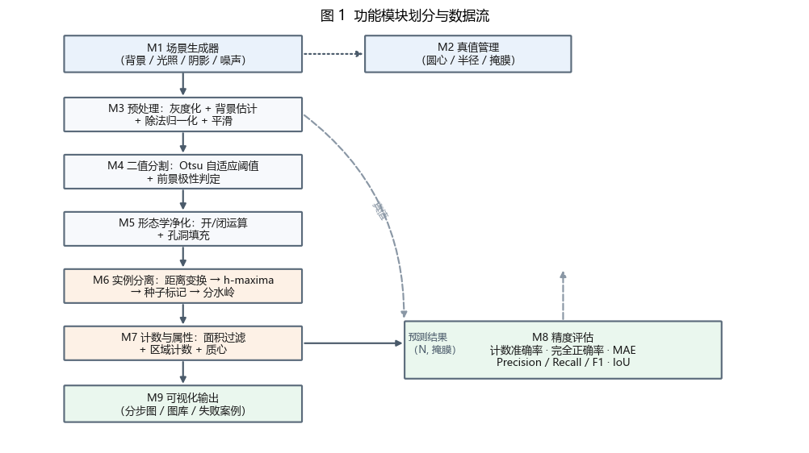
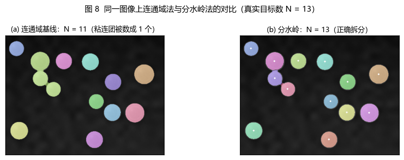
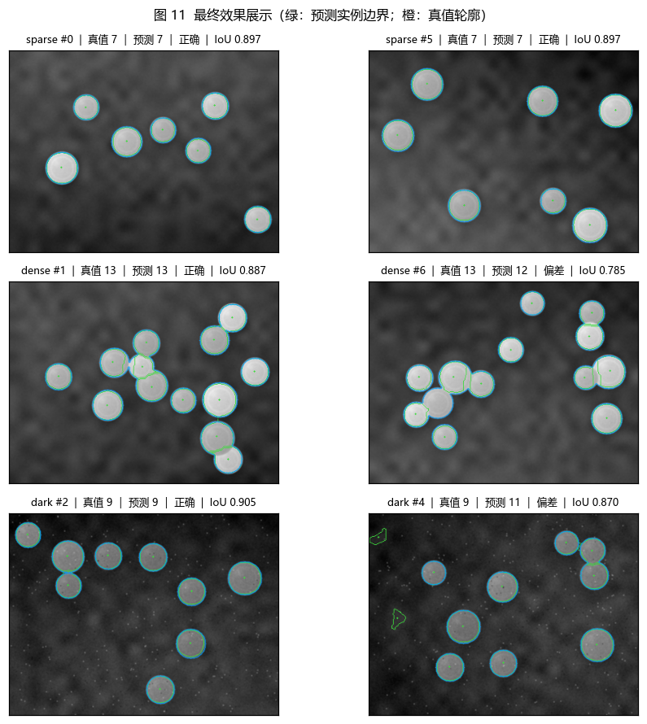

# 图像分割与计数（Image Segmentation & Counting）

基于传统图像处理流水线的**粘连目标分割与自动计数**：输入一张含若干圆形目标的图像，输出目标个数、每个目标的实例掩膜、质心与面积，并给出可量化的精度评估（计数准确率 / Exact / MAE / Precision / Recall / F1 / IoU）。

课程作业 · 第 6 组

| 姓名 | 序号 | 学号 | 分工 |
|---|---|---|---|
| 曾张帅 | j25 | 202608120021030 | 核心算法实现与参数调优、仿真数据集、定量实验 |
| 钱旭东 | j16 | 202608120021019 | 需求分析、功能模块与流程图、可视化、报告统稿 |

> 排版版报告见 `report.pdf`（Jupyter Notebook 导出，37 页）。

## 解决的问题

"数一数画面里有多少个物体"在工件计数、种子/谷粒计数、细胞计数、药片计数里都是高频工作。难点不在"分出前景"，而在**把连在一起的前景拆开**：一旦两个目标在图像上接触，二值前景就连成一团，纯连通域法会把 2 个目标数成 1 个。本项目用 **距离变换 + h-maxima 种子 + 分水岭**解决粘连拆分，并在自建的可控仿真数据集上做像素级定量评估。

## 方法流水线

```
输入图像(BGR)
  → 灰度化
  → 高斯背景估计(σ=25) + 除法归一化  I/(L+ε)     # 抵御光照不均、暗角
  → Otsu 自适应阈值 + 前景极性判定                 # 无需人工调阈值
  → 形态学净化（开运算去噪 / 闭运算弥合 / 孔洞填充）
  → 距离变换 D(x)                                  # 目标中心成为局部极大
  → h-maxima 灰度重建（h = 0.25·D_max）            # 抑制伪峰、保留小目标峰
  → 种子标记 + cv2.watershed                       # 沿"山谷"切开粘连区域
  → 面积过滤(≥250 px) → 区域数 N + 质心/面积/实例掩膜
  → 与真值比对：计数准确率、Exact、MAE、P/R/F1、IoU
```



核心思想：二值化只回答"哪些像素是目标"，而"一共几个目标"必须靠**实例分离**回答——距离变换把目标中心变成峰顶，h-maxima 把峰顶提成种子，分水岭再沿两个峰之间的"山谷"把粘连区域切开。

## 代码结构

算法与实验在 notebook 里按"分步运行"展开；同一套代码也已整理成可直接 import 的 Python 包，两者函数体完全一致、指标可以对上（见下方"复现一致性"）。

```
src/
├── __init__.py      统一导出
├── scene.py         仿真场景生成（M1/M2）：背景纹理/光照/暗角/阴影/噪声 + 真值掩膜 + 4 个失败案例
├── pipeline.py      分割流水线（M3~M7）：preprocess / binarize / distance_and_seeds /
│                    watershed_instances / baseline_cc，以及真实图像入口 count_image
├── metrics.py       精度评估（M8）：质心匹配、逐图 IoU/计数准确率、按场景汇总、两组鲁棒性扫描
└── viz.py           实例着色等可视化工具
run_demo.py          命令行入口：生成数据 → 跑流程 → 打印指标（支持 --sweeps / --image）
```

## 定量结果

在 3 个场景共 45 张图、435 个真实目标上评估（随机种子固定，结果可完整复现）：

| 场景 | 特点 | 计数准确率 | 完全正确率 | IoU |
|---|---|---|---|---|
| sparse | 稀疏、无粘连 | 100.00% | 100.0% | 0.9039 |
| dense | 密集、30%~40% 重叠 | 93.85% | 46.7% | 0.8773 |
| dark | 低对比度、强暗角、椒盐噪声 | 94.07% | 60.0% | 0.8790 |
| **整体** | 45 张图 / 435 目标 | **95.97%** | 68.9% | **0.8867** |

作为对照，同一条流水线上去掉分水岭、只做连通域计数（基线）：

| 方法 | 计数准确率 | F1 | 说明 |
|---|---|---|---|
| 连通域基线 | 83.82% | 0.8112 | 粘连团被数成 1 个 |
| 本项目（分水岭） | **95.97%** | **0.9654** | 收益全部来自密集粘连场景（63% → 93.85%） |

单图端到端耗时约 35–40 ms（纯 CPU，无 GPU，随机器负载浮动）。鲁棒性扫描：最小间距系数 gap ≥ 0.85 时准确率 99.0%，gap = 0.70 → 92.7%，gap ≤ 0.55 降到约 89.6%（连通域基线在 gap = 1.00 时也只有 86.5%）；高斯噪声 σ 从 0 增到 20，准确率始终 ≥ 96.9%。

同一张图上两种方法的对比——**二值掩膜完全相同**，差别只在"是否把粘连团拆开"：



## 什么情况下成功 / 失败

- **成功**：目标分离或仅轻微接触；目标尺寸相近、接近圆形；光照均匀或缓慢变化；目标与背景灰度差 ≥ 40 级；目标不贴边、无严重遮挡。
- **失败**：① 重叠过深（圆心距 < 0.55(r₁+r₂)）导致距离场双峰合并 → **欠计数**；② 目标半径过小（直径 < 20 px）被形态学与面积阈值当噪声删掉 → **目标消失**；③ 镜面高光/强阴影制造伪峰 → **过计数**；④ 目标被画面边界截断 → 实例面积偏小、质心偏移，**IoU 下降但计数往往仍对**。

## 内容清单

| 文件 | 说明 |
|---|---|
| `report.pdf` | 课程报告排版版（37 页，由 `image_segmentation_counting.ipynb` 导出） |
| `image_segmentation_counting.ipynb` | 完整报告与代码（已执行，含全部输出图与数值）。结构：需求分析 → 功能划分与流程图 → 分步运行结果 → 准确率分析 → 项目总结 |
| `src/` | 与 notebook 同源的算法代码，拆成 scene / pipeline / metrics / viz 四个模块，可独立 import |
| `run_demo.py` | 命令行入口：生成仿真数据、跑完整流程、打印指标 |
| `figures/` | README 引用的三张关键图（模块数据流、方法对比、最终效果） |
| `requirements.txt` | 依赖版本 |
| `README.md` | 本文件 |

## 运行方式

### 方式一：跑脚本（不需要 Jupyter）

```bash
pip install -r requirements.txt
python run_demo.py                 # 每场景 15 张（与报告一致，共 45 张），打印逐场景与整体指标
python run_demo.py --n 5           # 每场景 5 张，快速看结果
python run_demo.py --sweeps        # 额外跑重叠度 / 噪声两组鲁棒性扫描
python run_demo.py --image coins.jpg --out out   # 对真实照片计数，掩膜存到 out/mask.png
```

脚本输出的整体指标与报告完全一致（计数准确率 95.97%、完全正确率 68.9%、MAE 0.44、F1 0.9654、前景并集 IoU 0.8867），汇总表会写到 `out/summary.csv`。

### 方式二：跑 notebook（出报告里的全部图）

```bash
jupyter lab image_segmentation_counting.ipynb   # 或 jupyter notebook
```

打开后 `Kernel → Restart & Run All`，即可复现全部图表与指标（随机种子固定为 2026）。

### 当库用

```python
from src import count_image, evaluate_dataset, build_dataset, summarize

n, res = count_image("your_image.jpg")      # 计数 + 实例掩膜 + 每个区域的质心/面积
print("目标数:", n)

df = evaluate_dataset({"dense": build_dataset("dense", n_img=5)})
print(summarize(df))
```

`count_image` 内部用 `np.fromfile + cv2.imdecode` 读图，因此兼容中文路径。

## 最终效果

绿色细线为预测实例边界，橙色圈为真值轮廓；图上标题给出真值数、预测数与单图 IoU（含一张欠计数、一张过计数的失败样例）：



## 环境

Windows 11 · Python 3.10.16 · OpenCV 4.11.0 · NumPy 1.23.5 · Pandas 2.2.3 · Matplotlib 3.10.9 · 纯 CPU 推理（无需 GPU）
